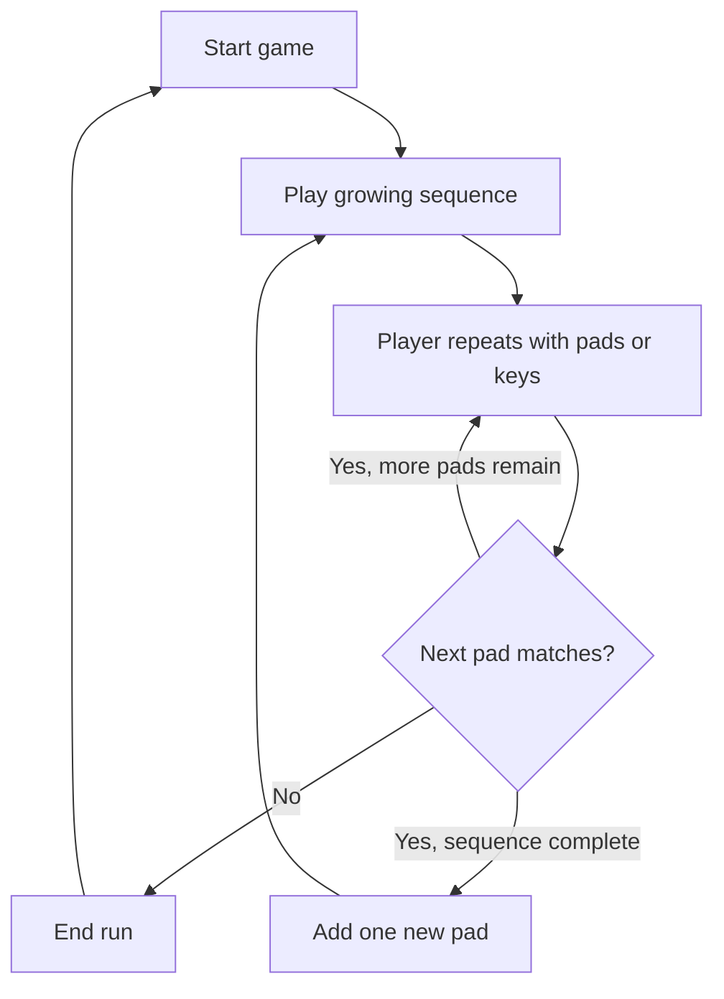

# Pulse Four

Pulse Four is a small sequence-memory game built with Vue 3, TypeScript, and Vite. Watch the four original light pads, then repeat their growing sequence. The game runs entirely in your browser; your personal best is saved locally.

**Play:** [oscarmmi.github.io/simon](https://oscarmmi.github.io/simon/)

## How to play

1. Select **Start a new game** and watch the pad light up.
2. Repeat the sequence by clicking/tapping the pads or using **Q/W/A/S** (also **1/2/3/4**).
3. Each complete sequence adds one more pulse. One wrong pad ends the run.
4. Press **R** or choose **Play again** to start over. Sound can be turned off at any time.

## Run locally

```sh
npm install
npm run dev
```

Run the game-logic tests and production build:

```sh
npm test
npm run build
```

## Game loop



## Built with

- Vue 3 + TypeScript + Vite
- Vitest for pure game-logic tests
- Web Audio API for optional pad tones
- GitHub Pages deployment from the `main` branch
